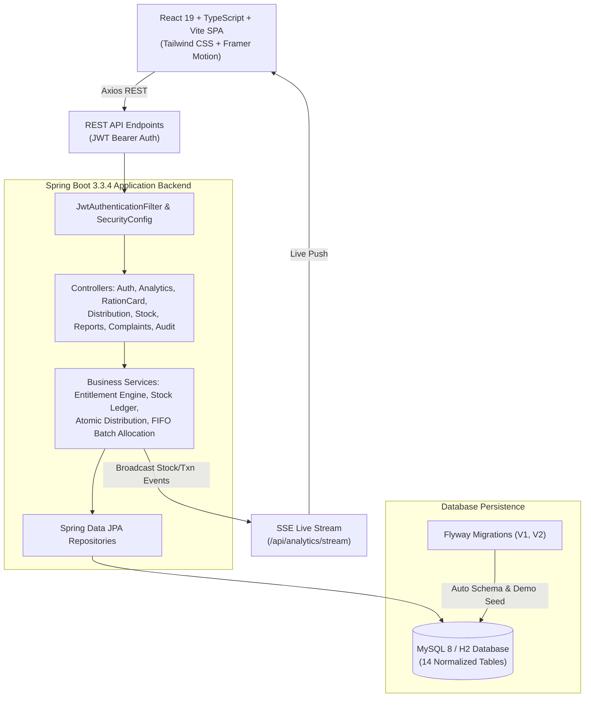

<p align="center">
  
</p>

<h1 align="center">🌾 Smart Ration Shop Management System</h1>
<h3 align="center">Real-Time Inventory Analytics & Public Distribution System (PDS) Portal</h3>

<p align="center">
  <a href="https://spring.io/projects/spring-boot"></a>
  <a href="https://www.oracle.com/java/"></a>
  <a href="https://react.dev/"></a>
  <a href="https://vitejs.dev/"></a>
  <a href="https://tailwindcss.com/"></a>
  <a href="https://www.framer.com/motion/"></a>
  <a href="https://www.mysql.com/"></a>
  <a href="https://flywaydb.org/"></a>
  <a href="LICENSE"></a>
</p>

---

## 📖 Project Overview & Description

**Smart Ration Shop Management System** is a production-grade, enterprise full-stack web application designed to modernize the **Public Distribution System (PDS)** and **Fair Price Shops (FPS)** under the **National Food Security Act (NFSA)**.

In conventional manual ration shops, paper registers and disconnected weighing counters frequently suffer from diversion of subsidized foodgrains, phantom beneficiaries, ghost stock records, and lack of real-time supply chain transparency.

This system replaces obsolete physical ledgers with a transparent, digitized, and verifiable platform featuring:
- **Statutory Entitlement Engine**: Computes dynamic monthly grain quotas (Rice, Wheat, Sugar, Kerosene, Dal) based on ration card classifications (**AAY - Antyodaya Anna Yojana**, **PHH/BPL - Priority Household**, and **NPHH/APL - Non-Priority Household**) and family unit sizes.
- **Atomic Point-of-Sale (POS) Distribution**: Prevents double-dipping and over-allocation with atomic database transactions, idempotency key guarantees, and printable tamper-evident authorization receipts.
- **Traceable Stock Ledger**: Full FIFO (First-In-First-Out) batch tracking from Food Corporation of India (FCI) warehouse inward consignments down to individual citizen distributions.
- **Real-Time Analytics & Live Streaming**: Low-stock alerts, consumption velocity indicators, stockout projections, and live Server-Sent Events (SSE) push notifications.
- **Citizen Grievance Redressal**: Built-in grievance ticketing module for citizens to report stock shortages or service discrepancies.
- **Immutable Security Audit Log**: Cryptographically recorded operational audit trails tracking all administrative and inventory adjustments.

---

## 🎨 Unique UI/UX & Visual Innovations

- **3D Opening Book Login Animation**: 
  The login screen presents a hardcover Public Distribution Ledger register with the official gold-embossed seal. Upon mounting, the book smoothly hinges open in 3D perspective (`perspective: 2200px`), fanning open intermediate parchment leaves to reveal an open two-page registry spread (Official Registry Folio on the left and Digital Counter Sign-In Terminal on the right), with an interactive **"Replay 3D Book Opening"** action.
- **Falling Green Leaves & Golden Sand Particles Breeze**:
  A lightweight particle engine running across all views that gently drifts organic green tea/wheat leaves and warm golden sand dust across the screen, evoking a natural agricultural harvest atmosphere.
- **Pristine White Theme**:
  High-contrast, clean government design system using crisp white surfaces (`#ffffff`, `#f8fafc`), deep navy accents (`#0e487a`), rich emerald green highlights (`#059669`), and warm amber tones (`#f59e0b`).
- **5-Second 3D Floating Crest Splash Intro**:
  A dedicated portal entrance (`/`) featuring the official Smart Ration crest floating in 3D with ambient lighting and an automated 5-second progress countdown transitioning to `/login`.

---

## 🛠️ Technology Stack

### **Frontend**
| Technology | Version | Purpose |
| :--- | :--- | :--- |
| **React** | `19.0.0` | Core UI library for component-based Single Page Application (SPA) |
| **TypeScript** | `5.6.3` | Strict type safety, interfaces, and build-time validation |
| **Vite** | `8.3.5` | Lightning-fast build tooling and Hot Module Replacement (HMR) |
| **Tailwind CSS** | `3.4.17` | Utility-first responsive CSS styling with custom government color tokens |
| **Framer Motion** | `12.40.0` | 3D book transforms, physics-based page curls, and particle effects |
| **Recharts** | `2.15.1` | Interactive analytics charts (Volume trends, commodity donuts, velocity) |
| **Axios** | `1.7.9` | Promise-based HTTP client with JWT interceptors |
| **Lucide React** | `0.475.0` | Modern, accessible iconography |
| **React Router** | `6.29.0` | Client-side routing with role-based route guards |

### **Backend**
| Technology | Version | Purpose |
| :--- | :--- | :--- |
| **Java** | `21 LTS` | Modern LTS Java runtime environment |
| **Spring Boot** | `3.3.4` | Enterprise application framework |
| **Spring Web MVC** | `3.3.4` | RESTful API endpoints and Server-Sent Events (SSE) streaming |
| **Spring Security** | `3.3.4` | Stateless JWT authentication and Role-Based Access Control (RBAC) |
| **Spring Data JPA** | `3.3.4` | Hibernate ORM repository abstractions |
| **Flyway** | `10.10.0` | Version-controlled database schema migrations and seed scripts |
| **JJWT (io.jsonwebtoken)**| `0.12.6` | HMAC-SHA384 encrypted JSON Web Token creation & verification |
| **Lombok** | `1.18.34`| Boilerplate reduction for entity models and DTOs |
| **Maven** | `3.8+` | Dependency management and build lifecycle |

### **Database & Persistence**
| Technology | Version | Purpose |
| :--- | :--- | :--- |
| **MySQL** | `8.0+` | Primary production relational database (14 normalized tables) |
| **H2 Database** | `2.2+` | Embedded zero-configuration in-memory database for rapid local testing |

---

## 🏛️ System Architecture



---

## 👥 User Roles & Demo Accounts

The application implements strict Role-Based Access Control (RBAC) across both the Spring Security filter chain and React Router client guards.

| Role | Username | Password | Purpose & Permissions |
| :--- | :--- | :--- | :--- |
| **Super Admin** | `admin` | `admin123` | Department-wide oversight, shop registration, user management, entitlement rule configuration, global stock & audit monitoring. |
| **Shop Operator** | `operator` | `operator123` | Operate Fair Price Shop (FPS-1001), inward stock from FCI, POS card validation, atomic commodity distribution, printable receipts, stock adjustments. |
| **Beneficiary** | `beneficiary` | `beneficiary123` | Ration cardholder (`RC-KA-01-987654`), view live monthly entitlement, remaining balance, check shop commodity availability, download past receipts, submit complaints. |
| **Auditor** | `auditor` | `auditor123` | Read-only inspection of stock ledger, physical vs book stock reconciliation, discrepancy alerts, export tamper-evident audit logs to CSV. |

> **Tip**: On the login page, you can click on any of the **Quick-Select Demo Account** cards to instantly populate the credentials.

---

## 🚀 How to Run the Project

### Prerequisites
Before running the application, make sure you have the following installed on your system:
- **Java Development Kit (JDK) 21 LTS** (`java -version`)
- **Apache Maven 3.8+** (`mvn -v`)
- **Node.js 20+** and **npm** (`node -v`, `npm -v`)
- *(Optional)* **MySQL 8.0+** (if running with MySQL instead of H2)
- *(Optional)* **Docker & Docker Compose** (for single-command containerized launch)

---

### Method 1: Running Locally (Recommended for Development)

#### 1. Start the Backend (Spring Boot)

1. Open a terminal and navigate to the `backend` folder:
   ```bash
   cd SmartRation/backend
   ```

2. Choose one of the two database options:

   - **Option A: Instant Zero-Config Launch with H2 (Fastest, no MySQL setup required)**:
     ```bash
     java -jar target/smart-ration-backend-1.0.0.jar --spring.profiles.active=h2
     ```
     *Or if compiling from source with Maven:*
     ```bash
     mvn spring-boot:run -Dspring-boot.run.profiles=h2
     ```

   - **Option B: Running with MySQL 8**:
     Ensure your MySQL service is running, create the database:
     ```sql
     CREATE DATABASE smart_ration_db;
     ```
     Set your database credentials in `backend/src/main/resources/application.yml` (or via environment variables `SPRING_DATASOURCE_USERNAME` and `SPRING_DATASOURCE_PASSWORD`), then run:
     ```bash
     mvn spring-boot:run
     ```

3. The backend server will start at:
   ```text
   http://localhost:8080
   ```
   Flyway will automatically execute migrations `V1__create_tables.sql` and `V2__seed_demo_data.sql`, populating the database with demo accounts, shops, cards, and inventory batches.

---

#### 2. Start the Frontend (React + Vite)

1. Open a second terminal and navigate to the `frontend` folder:
   ```bash
   cd SmartRation/frontend
   ```

2. Install all required dependencies:
   ```bash
   npm install --legacy-peer-deps
   ```

3. Launch the Vite development server:
   ```bash
   npm run dev
   ```

4. The frontend will be available at:
   ```text
   http://localhost:5173
   ```

5. Open your browser and navigate to `http://localhost:5173`. You will see the **3D Floating Crest Splash Screen** for 5 seconds, followed by the **3D Opening Book Login Screen**.

---

### Method 2: Running with Docker Compose (Single Command)

If you have Docker and Docker Compose installed, you can start the entire stack (MySQL 8, Backend, and Frontend) in one command:

1. In the project root directory, run:
   ```bash
   docker-compose up --build -d
   ```

2. Docker Compose will automatically build the containers and launch:
   - **Frontend**: `http://localhost:5173`
   - **Backend API**: `http://localhost:8080`
   - **MySQL 8 Database**: `localhost:3306`

3. To view running logs:
   ```bash
   docker-compose logs -f
   ```

4. To stop the containers:
   ```bash
   docker-compose down
   ```

---

## 🧪 Testing & Build Verification

### Backend Automated Test Suite
The backend includes automated tests covering:
- Statutory Entitlement Formulae (`PER_MEMBER`, `FIXED_PER_CARD`, Max Quota Caps)
- Atomic POS Distribution with FIFO Batch Deduction
- Concurrency Protection & Over-Entitlement Rejection (HTTP 422)
- Idempotency Key deduplication

To run the backend tests:
```bash
cd backend
mvn test
```

Expected result:
```text
[INFO] Running com.smartration.DistributionServiceTest
[INFO] Tests run: 3, Failures: 0, Errors: 0, Skipped: 0
[INFO] Running com.smartration.EntitlementServiceTest
[INFO] Tests run: 2, Failures: 0, Errors: 0, Skipped: 0
[INFO] BUILD SUCCESS
```

### Frontend Production Build
To verify TypeScript compilation and generate the optimized production bundle:
```bash
cd frontend
npm run build
```

Expected output:
```text
✓ 3036 modules transformed.
✓ built in ~8s
```

---

## 📡 Key REST API Endpoints

| Method | Endpoint | Description | Role Required |
| :--- | :--- | :--- | :--- |
| `POST` | `/api/auth/login` | Authenticate user & return JWT token | Public |
| `GET` | `/api/auth/me` | Fetch currently authenticated user profile | Any Authenticated |
| `GET` | `/api/analytics` | Aggregated dashboard KPIs and commodity stock metrics | Any Authenticated |
| `GET` | `/api/analytics/stream` | Server-Sent Events (SSE) live stock update channel | Any Authenticated |
| `GET` | `/api/ration-cards` | Search and filter ration cards | Staff / Auditor |
| `GET` | `/api/ration-cards/{id}/entitlements` | Compute dynamic monthly entitlement and quota | Operator / Beneficiary |
| `POST` | `/api/distributions` | Execute atomic POS distribution transaction | Operator / Admin |
| `GET` | `/api/distributions/receipt/{ref}`| Fetch printable transaction receipt | Any Authenticated |
| `POST` | `/api/stock/receive` | Inward stock consignment from warehouse | Operator / Admin |
| `POST` | `/api/stock/adjust` | Record authorized inventory adjustment with audit reason | Operator / Admin |
| `GET` | `/api/stock/movements` | Query traceable inventory ledger movements | Staff / Auditor |
| `GET` | `/api/reports/reconciliation` | Compare physical vs book stock & detect discrepancies | Staff / Auditor |
| `GET` | `/api/reports/export/distributions` | Export date-wise distribution ledger to CSV | Staff / Auditor |
| `POST` | `/api/complaints` | File citizen grievance / complaint | Beneficiary |
| `GET` | `/api/audit-logs` | Immutable audit ledger of all privileged operations | Auditor / Admin |

---

## 📂 Project Directory Structure

```text
SmartRation/
├── backend/
│   ├── src/
│   │   ├── main/
│   │   │   ├── java/com/smartration/
│   │   │   │   ├── config/          # Spring Security, JWT Filter, CORS, SSE
│   │   │   │   ├── controller/      # REST API Controllers
│   │   │   │   ├── dto/             # Request & Response Data Transfer Objects
│   │   │   │   ├── entity/          # JPA Hibernate Entities (14 tables)
│   │   │   │   ├── repository/      # Spring Data JPA Repositories
│   │   │   │   ├── service/         # Business Logic & Entitlement Engine
│   │   │   │   └── SmartRationApplication.java
│   │   │   └── resources/
│   │   │       ├── db/migration/    # Flyway V1 Tables & V2 Demo Data Seed
│   │   │       ├── application.yml  # MySQL production configuration
│   │   │       └── application-h2.yml # Zero-config in-memory profile
│   │   └── test/                    # JUnit 5 & Mockito test suites
│   └── pom.xml                      # Maven project configuration
├── frontend/
│   ├── public/
│   │   └── smart-ration-logo.png    # Official Smart Ration Crest Logo
│   ├── src/
│   │   ├── components/              # 3D Logo, Navbar, Sidebar, Particles, Badges
│   │   ├── context/                 # AuthContext (JWT State & Roles)
│   │   ├── pages/                   # All application pages
│   │   │   ├── SplashIntroPage.tsx  # 5-second 3D Crest Splash Screen
│   │   │   ├── LoginPage.tsx        # 3D Opening Book Login Screen
│   │   │   ├── DashboardPage.tsx    # Live KPIs & Stock Velocity Analytics
│   │   │   ├── DistributionPage.tsx # Point-of-Sale (POS) Quota Distribution
│   │   │   ├── StockManagementPage.tsx # Inward Stock & Adjustments Ledger
│   │   │   ├── RationCardsPage.tsx  # Ration Card Directory & Enrollment
│   │   │   ├── ReportsPage.tsx      # Stock Reconciliation & CSV Exports
│   │   │   ├── ComplaintsPage.tsx   # Citizen Grievance Portal
│   │   │   ├── AuditLogsPage.tsx    # Immutable Security Audit Ledger
│   │   │   ├── EntitlementsPage.tsx # Statutory Rule Matrix Configuration
│   │   │   └── UsersShopsPage.tsx   # FPS Shop & User Account Directory
│   │   ├── services/                # Axios API client modules
│   │   └── types/                   # TypeScript interfaces & domain models
│   ├── package.json
│   ├── tailwind.config.js
│   └── vite.config.ts
├── docker-compose.yml               # Multi-container orchestration
└── README.md                        # Master Project Documentation
```

---

## 🛡️ License

This project is licensed under the **MIT License** — feel free to use, modify, and distribute it for academic, research, or enterprise evaluation purposes.
# Smart-Ration-Shop-Management-System-With-Real-Time-Stock-Analytics

