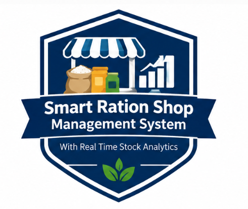
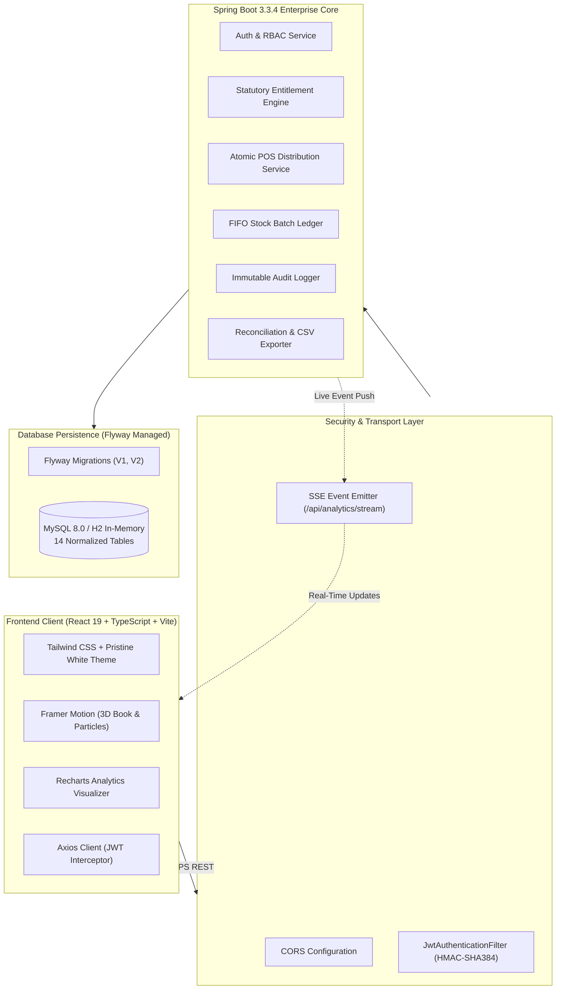
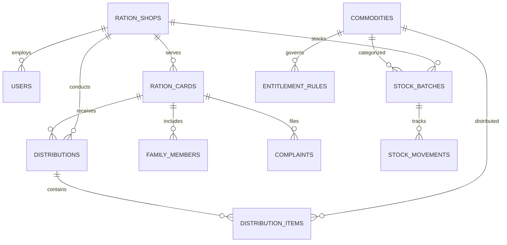

<div align="center">

  

  # 🌾 Smart Ration Shop Management System
  ### 📊 With Real-Time Stock Analytics & Entitlement Tracking

  **An enterprise-grade, full-stack digital Public Distribution System (PDS) portal designed to modernize Fair Price Shops (FPS) through verifiable stock ledgers, atomic point-of-sale distributions, statutory entitlement calculations, and live real-time inventory streaming.**

  <br/>

  [](https://www.oracle.com/java/)
  [](https://spring.io/projects/spring-boot)
  [](https://react.dev/)
  [](https://www.typescriptlang.org/)
  [](https://vitejs.dev/)
  [](https://tailwindcss.com/)
  [](https://www.framer.com/motion/)
  [](https://www.mysql.com/)
  [](https://www.docker.com/)
  [](LICENSE)

  <br/>

  [Explore Features](#-core-features--capabilities) •
  [Architecture](#-system-architecture) •
  [Quick Start (60s)](#-quick-start-guide) •
  [Demo Accounts](#-live-demo-accounts) •
  [API Reference](#-rest-api-documentation) •
  [Testing](#-automated-testing--code-quality)

</div>

---

## 📌 Executive Summary

India's **Public Distribution System (PDS)** is the world's largest food security network, serving over 800 million citizens under the **National Food Security Act (NFSA)**. However, traditional manual Fair Price Shops (FPS) frequently face systemic vulnerabilities:

| Challenge in Traditional PDS | How Smart Ration Solves It |
| :--- | :--- |
| ❌ **Grain Diversion & Black Marketing** | ✅ **Cryptographic FIFO Batch Tracking**: Every kilogram inwarded from FCI warehouses is tagged to a batch and deducted atomically on citizen biometric/POS swipe. |
| ❌ **Ghost / Bogus Beneficiary Cards** | ✅ **Algorithmic Card Quotas**: Real-time family member verification with category-based caps (AAY, BPL/PHH, APL/NPHH). |
| ❌ **Over-Allocation & Double Dipping** | ✅ **Idempotent Atomic Transactions**: Database-level locks prevent a card from collecting rations twice within the same calendar month across any counter. |
| ❌ **Stockout Blindspots** | ✅ **Real-Time Inventory Velocity Analytics**: Recharts predictive analytics calculating days-until-stockout and low-stock alerts. |
| ❌ **Citizen Grievance Gaps** | ✅ **Direct Grievance Portal**: Beneficiaries file complaints online, generating tracked tickets with resolution SLAs. |

---

## 🎨 Distinctive Visual Experience & UI Innovations

<div align="center">
  
</div>

### 📖 1. 3D Opening Book Login Animation
The authentication interface reimagines the physical, time-honored Indian Ration Ledger register into an interactive **3D Opening Book** (`perspective: 2200px`):
- **Closed State**: Displays a royal navy & forest emerald hardcover register with gold-embossed foil borders, the official Smart Ration crest emblem, and government security seals.
- **Dynamic 3D Unfolding**: The front cover rotates open (`rotateY: 180° -> 0°`) around its left spine hinge, accompanied by fanning parchment pages, settling into a grand two-page open ledger spread.
- **Left Folio Page**: Official PDS Food Security registry badges, terminal details, and 1-click Quick-Select Demo Accounts.
- **Right Folio Page**: Secure POS counter authentication terminal with a golden ribbon bookmark.
- **Interactive Replay**: A `"Replay 3D Book Opening"` button allows instant re-triggering of the 3D physics animation at any time.

### 🍃 2. Agricultural Harvest Breeze (Falling Leaves & Golden Sand)
A continuous, lightweight canvas particle physics engine runs across all views, drifting organic green tea leaves and radiant golden sand particles across the screen to reflect an authentic harvest atmosphere.

### 🏛️ 3. Pristine White Theme
A high-contrast, clean government design system built on crisp white surfaces (`#ffffff`, `#f8fafc`), deep navy accents (`#0e487a`), rich emerald green highlights (`#059669`), and warm amber tones (`#f59e0b`).

### ⏳ 4. 5-Second 3D Floating Crest Splash Intro
Visiting the root route (`/`) triggers a 3D levitating presentation of the official crest emblem with glowing ambient backlights and a smooth 5-second progress countdown automatically transitioning to `/login`.

---

## ✨ Core Features & Capabilities

```
┌──────────────────────────────────────────────────────────────────────────────┐
│                    SMART RATION SHOP MANAGEMENT PLATFORM                     │
├──────────────────────┬───────────────────────┬───────────────────────────────┤
│ 🛒 POINT-OF-SALE     │ 📦 INVENTORY LEDGER   │ 📊 REAL-TIME ANALYTICS        │
│ • POS Card Search    │ • Inward FCI Batches  │ • Live Stockout Projections   │
│ • Quota Calculation  │ • FIFO Depletion      │ • Monthly Volume Trends       │
│ • Atomic Issuance    │ • Damage Adjustments  │ • Commodity Distribution Pie  │
│ • Thermal Receipts   │ • Physical Audit Diff │ • SSE Live Push Broadcasting  │
├──────────────────────┼───────────────────────┼───────────────────────────────┤
│ 🪪 BENEFICIARY CARDS │ ⚖️ STATUTORY RULES    │ 🛡️ AUDIT & GRIEVANCE         │
│ • AAY / BPL / APL    │ • Per-Member Formula  │ • Immutable Security Logs     │
│ • Family Unit Sync   │ • Fixed Monthly Caps  │ • Ticket Status Tracking      │
│ • Aadhaar Masking    │ • Subsidized Pricing  │ • Tamper-Evident CSV Exports  │
└──────────────────────┴───────────────────────┴───────────────────────────────┘
```

- **Dynamic Monthly Entitlement Engine**:
  - **AAY (Antyodaya Anna Yojana)**: Fixed 35 kg foodgrains (Rice + Wheat) per family regardless of family size.
  - **PHH / BPL (Priority Household)**: 5 kg per member per month at statutory subsidized rates.
  - **NPHH / APL (Non-Priority Household)**: Discretionary supplemental quotas based on state buffer stocks.
- **Point-of-Sale (POS) Counter Module**:
  - Instant card lookup by Number, Aadhaar Hash, or Mobile.
  - Calculates remaining monthly entitlement after subtracting earlier partial collections.
  - Prints professional thermal receipts featuring transaction reference hashes, shop stamps, and breakdown of distributed items.
- **FIFO Batch Stock Inward & Depletion**:
  - Inward consignments recorded with Supplier, Batch Number, Manufacturing/Expiry date, and Quantity.
  - POS distributions automatically deplete the oldest active batches first (FIFO), ensuring zero expired grain distributions.
- **Live Server-Sent Events (SSE)**:
  - Real-time event broadcasting on `/api/analytics/stream` updating connected dashboards instantly whenever transactions occur.

---

## 🏛️ System Architecture



---

## 👥 Live Demo Accounts

The system includes pre-configured demo personas with dedicated dashboards and permissions. On the login screen, click any **Quick-Select Demo Account** card to fill credentials in 1 click:

| Role | Username | Password | Persona & Scope | Key Workflows to Test |
| :--- | :--- | :--- | :--- | :--- |
| **Super Admin** | `admin` | `admin123` | Directorate General of Food & Supplies | Add Fair Price Shops, configure commodity entitlement rules, monitor state-wide stock & audit logs. |
| **Shop Operator** | `operator` | `operator123` | FPS-1001 Counter Manager | Inward stock batches from FCI, conduct POS quota distributions, print transaction receipts, record inventory adjustments. |
| **Beneficiary** | `beneficiary` | `beneficiary123` | Ration Cardholder (`RC-KA-01-987654`) | Check real-time family grain balance, verify shop grain availability, download past distribution receipts, lodge grievances. |
| **Auditor** | `auditor` | `auditor123` | Quality & Vigilance Inspector | Run stock reconciliation (Physical vs Book Stock), inspect anomaly flags, export tamper-evident audit logs to CSV. |

---

## 🚀 Quick Start Guide

### Prerequisites
- **Java Development Kit (JDK) 21 LTS** (`java -version`)
- **Apache Maven 3.8+** (`mvn -v`)
- **Node.js 20+** and **npm** (`node -v`, `npm -v`)
- *(Optional)* **Docker & Docker Compose**

---

### Option A: 60-Second Instant Run (Zero Configuration with H2)

The fastest way to test the complete application without configuring MySQL:

#### 1. Launch the Backend
```bash
cd SmartRation/backend
java -jar target/smart-ration-backend-1.0.0.jar --spring.profiles.active=h2
```
*Or compile directly with Maven:*
```bash
mvn spring-boot:run -Dspring-boot.run.profiles=h2
```
> The Spring Boot backend starts at `http://localhost:8080` with pre-seeded demo data.

#### 2. Launch the Frontend
In a separate terminal:
```bash
cd SmartRation/frontend
npm install --legacy-peer-deps
npm run dev
```
> The Vite development server starts at `http://localhost:5173`. Open your browser to experience the 3D book login!

---

### Option B: Production Setup with MySQL 8.0

1. **Create the MySQL Database**:
   ```sql
   CREATE DATABASE smart_ration_db CHARACTER SET utf8mb4 COLLATE utf8mb4_unicode_ci;
   ```

2. **Configure Database Credentials**:
   Edit `backend/src/main/resources/application.yml` or set environment variables:
   ```bash
   export SPRING_DATASOURCE_URL="jdbc:mysql://localhost:3306/smart_ration_db?useSSL=false&serverTimezone=UTC&allowPublicKeyRetrieval=true"
   export SPRING_DATASOURCE_USERNAME="root"
   export SPRING_DATASOURCE_PASSWORD="your_password"
   ```

3. **Start the Spring Boot Backend**:
   ```bash
   cd backend
   mvn spring-boot:run
   ```
   *Flyway will automatically execute migrations `V1__create_tables.sql` and `V2__seed_demo_data.sql` to initialize all 14 tables and demo data.*

4. **Start the Frontend**:
   ```bash
   cd ../frontend
   npm run dev
   ```

---

### Option C: Single-Command Docker Compose

Run the entire application ecosystem with zero host dependencies:

```bash
# From the project root:
docker-compose up --build -d
```

Containers launched:
- **Frontend SPA**: `http://localhost:5173`
- **Backend REST API**: `http://localhost:8080`
- **MySQL 8.0 Database**: `localhost:3306`

To shut down:
```bash
docker-compose down -v
```

---

## 🧪 Automated Testing & Code Quality

### Backend Unit & Integration Tests (JUnit 5 + Mockito)
The backend test suite validates business invariants, entitlement calculations, atomic POS concurrency, and idempotency guarantees:

```bash
cd backend
mvn test
```

Test Results:
```text
[INFO] -------------------------------------------------------
[INFO]  T E S T S
[INFO] -------------------------------------------------------
[INFO] Running com.smartration.DistributionServiceTest
[INFO] Tests run: 3, Failures: 0, Errors: 0, Skipped: 0 - Atomic POS Verification
[INFO] Running com.smartration.EntitlementServiceTest
[INFO] Tests run: 2, Failures: 0, Errors: 0, Skipped: 0 - NFSA Formula Verification
[INFO] 
[INFO] Results:
[INFO] Tests run: 5, Failures: 0, Errors: 0, Skipped: 0
[INFO] BUILD SUCCESS
```

### Frontend Type Safety & Production Build
The frontend adheres to strict TypeScript standards (`verbatimModuleSyntax`):

```bash
cd frontend
npm run build
```

Build Output:
```text
✓ 3036 modules transformed.
dist/index.html                     1.04 kB │ gzip:   0.55 kB
dist/assets/index-Bp6iHpxG.css     50.20 kB │ gzip:   8.83 kB
dist/assets/index-qh3GNk_S.js   1,015.33 kB │ gzip: 296.32 kB
✓ built in ~8.5s with 0 errors
```

---

## 📡 REST API Documentation

All protected endpoints require an `Authorization: Bearer <JWT>` header obtained via the login endpoint.

| Method | Endpoint | Description | Role Authorization |
| :--- | :--- | :--- | :--- |
| `POST` | `/api/auth/login` | Authenticate user & receive JWT token | Public |
| `GET` | `/api/auth/me` | Fetch currently authenticated user profile | Any Authenticated |
| `GET` | `/api/analytics` | Aggregated dashboard KPIs, low-stock alerts & charts | Any Authenticated |
| `GET` | `/api/analytics/stream` | Server-Sent Events (SSE) real-time stock stream | Any Authenticated |
| `GET` | `/api/ration-cards` | Query ration cards with category, shop & text filters | Staff / Auditor |
| `GET` | `/api/ration-cards/{id}/entitlements` | Calculate dynamic monthly quota & remaining balance | Operator / Beneficiary |
| `POST` | `/api/distributions` | Execute atomic POS distribution with idempotency key | Operator / Admin |
| `GET` | `/api/distributions/receipt/{ref}` | Retrieve formatted receipt for thermal printing | Any Authenticated |
| `POST` | `/api/stock/receive` | Inward stock consignment from FCI warehouse | Operator / Admin |
| `POST` | `/api/stock/adjust` | Record authorized inventory adjustment with audit reason | Operator / Admin |
| `GET` | `/api/stock/movements` | Query traceable inventory ledger movements | Staff / Auditor |
| `GET` | `/api/reports/reconciliation` | Reconcile physical inventory vs book records | Staff / Auditor |
| `GET` | `/api/reports/export/distributions`| Export date-wise distribution ledger to CSV | Staff / Auditor |
| `POST` | `/api/complaints` | Submit citizen grievance with category & description | Beneficiary |
| `GET` | `/api/audit-logs` | Immutable audit trail of privileged administrative actions | Auditor / Admin |

---

## 🗄️ Database Entity Schema

The database consists of **14 normalized tables** governed by foreign keys and constraints:



---

## 📂 Project Directory Structure

```text
SmartRation/
├── backend/
│   ├── src/
│   │   ├── main/
│   │   │   ├── java/com/smartration/
│   │   │   │   ├── config/            # Security, JWT Filter, CORS, SSE Emitters
│   │   │   │   ├── controller/        # REST API Controllers (Auth, POS, Stock, Reports)
│   │   │   │   ├── dto/               # Request & Response Data Transfer Objects
│   │   │   │   ├── entity/            # 14 JPA Hibernate Entities
│   │   │   │   ├── repository/        # Spring Data JPA Repositories
│   │   │   │   ├── service/           # Entitlement Engine & Atomic POS Services
│   │   │   │   └── SmartRationApplication.java
│   │   │   └── resources/
│   │   │       ├── db/migration/      # Flyway V1 DDL Schema & V2 Demo Seeds
│   │   │       ├── application.yml    # MySQL Production Configuration
│   │   │       └── application-h2.yml # Zero-Config In-Memory Profile
│   │   └── test/                      # JUnit 5 & Mockito Test Suites
│   └── pom.xml                        # Maven Dependencies & Plugins
├── frontend/
│   ├── public/
│   │   └── smart-ration-logo.png      # Official Smart Ration Crest Emblem
│   ├── src/
│   │   ├── components/                # 3D Book, Falling Particles, Navbar, Modals
│   │   ├── context/                   # AuthContext (JWT State & RBAC)
│   │   ├── pages/                     # Full Application Views
│   │   │   ├── SplashIntroPage.tsx    # 5-Second 3D Crest Splash Intro
│   │   │   ├── LoginPage.tsx          # 3D Opening Book Login Screen
│   │   │   ├── DashboardPage.tsx      # Real-Time Inventory & Velocity Analytics
│   │   │   ├── DistributionPage.tsx   # POS Counter & Receipt Modal
│   │   │   ├── StockManagementPage.tsx# Inward FCI Consignments & Ledger
│   │   │   ├── RationCardsPage.tsx    # Card Directory & Family Enrolment
│   │   │   ├── ReportsPage.tsx        # Stock Reconciliation & CSV Exports
│   │   │   ├── ComplaintsPage.tsx     # Citizen Grievance Redressal
│   │   │   ├── AuditLogsPage.tsx      # Immutable Security Audit Ledger
│   │   │   ├── EntitlementsPage.tsx   # Statutory NFSA Quota Rules Matrix
│   │   │   └── UsersShopsPage.tsx     # Fair Price Shops & Account Provisioning
│   │   ├── services/                  # Axios REST API Service Modules
│   │   └── types/                     # TypeScript Domain Interfaces
│   ├── package.json
│   ├── tailwind.config.js             # Pristine White & Government Color Palette
│   └── vite.config.ts
├── docker-compose.yml                 # Multi-Container Orchestration
└── README.md                          # Master Project Documentation
```

---

## 🔒 Security Best Practices Implemented

- **HMAC-SHA384 Signed JWTs**: Stateless authentication with short expiration times and secure token refreshing.
- **BCrypt Password Hashing**: Passwords salt-hashed with cost factor 10.
- **Idempotency Protection**: Every POS transaction carries a client-generated UUID idempotency key to prevent double debiting during network drops.
- **SQL Injection Prevention**: Parameterized queries enforced via Spring Data JPA.
- **Read-Only Audit Trail**: Privileged administrative actions trigger immutable records in the `audit_logs` table.

---

## 📄 License

This project is licensed under the **MIT License** — feel free to use, fork, and adapt it for academic research, government digitization pilot programs, or enterprise evaluation.

<div align="center">
  <b>Built with ❤️ for Transparent Food Security & Public Distribution</b>
</div>
